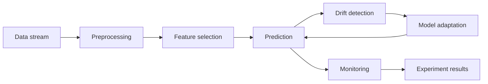
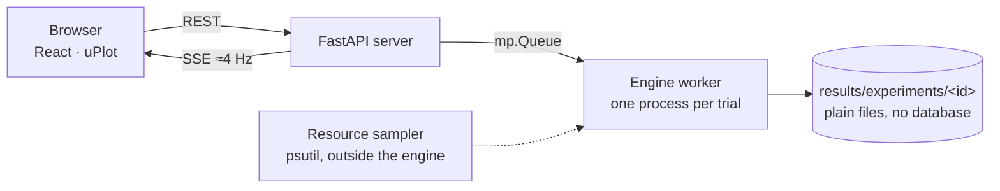

<div align="center">


# AdaptiveML Studio

**An experimentation platform that shows a machine-learning model losing accuracy when its data changes — and earning it back.**

[](#project-status)
[](https://www.python.org/)
[](https://riverml.xyz/)
[](https://fastapi.tiangolo.com/)
[](https://react.dev/)
[](https://www.typescriptlang.org/)
[](https://vite.dev/)
[](#tests)

</div>

---

## Overview

A model trained once on historical data can quietly become less accurate when the world it describes changes. **AdaptiveML Studio** makes that failure visible, and shows what an adaptive pipeline does about it — while measuring, *in the same run*, what the adaptation costs in processing time and memory.

It is the experimental instrument for the B.Tech project **“Cross Scale Adaptive ML for Accuracy Stability Under Varying Data Conditions”**, built from the team's review paper *Adaptive Machine Learning Pipelines for Evolving Data Streams: A Comprehensive Review*.

> **What this is not.** It is not a new ML algorithm, and it does not measure edge hardware. The constrained profile enforces budgets in software on the local machine and is labelled *simulated* everywhere it appears. Every number in the interface and in `results/` comes from an actual run; interpreting those numbers belongs to the research workstream, so the platform reports and never concludes.

## Real dataset workflows

The default **Dataset test** and **Experiments** screens use static Kaggle snapshots:
ELEC2 electricity (45,312 rows, eight features) and UCI room occupancy (20,560 rows,
five sensor features). Synthetic SEA scenarios remain available in an explicit
**Synthetic demo / benchmarks** disclosure.

- **Dataset test:** replay rows in order, compare static and adaptive learning, pause or stop, inspect events.
- **Experiments:** select the dataset, how it changes, the methods, replay length, warm-up, model
  seeds and resource profiles; run each trial in a fresh process and export the measured results.
  While a comparison runs, the page shows which method is running, where it is in the data, what
  it does with each row, its accuracy so far and the events it raises.
- Every CSV is checked against a recorded SHA-256 before running. The source, labels,
  feature columns, order and checksum are saved with the result. No synthetic noise or
  resampling is applied, and no label is ever altered.
- Predict first, then learn from that row's label. Warm-up rows are excluded from headline
  accuracy/F1.
- **Natural replay** (rows as recorded) is the default. Real datasets have no annotated drift
  points, so in that mode detection delay and before/after scores are unavailable.
- **Controlled drift** is opt-in: at a chosen row the values of two input columns are exchanged,
  arriving as a *sudden*, *gradual*, *incremental* or *recurring* change. Its position is known,
  so accuracy, precision, recall and F1 are reported **before, during and after** it for every
  method, next to a **control** run of the same method on the untouched rows. Such a run is
  labelled "Real data + controlled drift" everywhere and is never presented as plain real-data
  drift.

Restore the local files with `python3 scripts/prepare_kaggle.py`; see
[data/README.md](data/README.md) for provenance and methodology. Dataset files remain
local and ignored by Git; the catalog and preparation script are versioned. `seeding.py`
still controls model reproducibility; it does not generate these real observations.

## Why this project?

Data changes. A spam filter meets a new kind of spam; a sensor drifts; buying habits shift after a holiday. In streaming terms, the relationship between the inputs and the correct answer moves — **concept drift** — and a model that learned the old relationship keeps applying it.

Two questions follow, and the literature usually answers only the first:

1. **Can the system notice and recover?** — accuracy, F1, detection delay, adaptation outcome.
2. **What did that cost?** — processing time per sample, p95/p99, CPU, memory, model size.

This platform always answers both, from the same run, on the same machine.

## What the platform demonstrates

```
DATA CHANGES  →  ACCURACY FALLS  →  DRIFT IS DETECTED  →  THE MODEL ADAPTS  →  RECOVERY IS OBSERVED
                                                                                        ↓
                                                        ACCURACY · LATENCY · CPU · MEMORY ARE MEASURED
```

A run of the validated demo scenario, as an example of what gets recorded (measurements, not claims): accuracy before the drift **93.4 %**, lowest point after it **83.2 %**, **94.6 %** after adaptation; the drift was detected **311 samples** after it happened, and the replacement model was promoted **167 samples** later.

## Key features

- **Four screens, in order of depth** — **Home** explains the problem and the system before any instrument appears; **Live** demonstrates it on a running stream; **Experiments** holds the recorded evidence; **Method** is the research explanation.
- **Live screen** — one timeline (the sample index): a plain-English status hero, the run's context in one line, the accuracy of the adaptive pipeline against a static baseline with drift, detection and adaptation flagged where they happened, a "what happened" story, the pipeline as a flow with its conditional adaptation branch, and an event log. Diagnostics stay folded away until asked for.
- **Guided demo mode** — narration that advances on *real events* from the running stream, for presenting without narrating manually.
- **Experiments** — run a preset comparison (methods × profiles × rates × seeds), browse past runs, open one, and **re-run it to check reproducibility**.
- **Method page** — nine numbered sections with a contents list that follows the reader: the problem, concept drift, the pipeline, detection, adaptation, resource awareness, evaluation, the research gap and traceability table, and the current limitations.
- **Explain everywhere** — every technical term carries an ⓘ that answers *what it is*, *how this project measures it*, and *why it matters*, with the formula where one exists.
- **Presentation mode** — larger type, larger charts and fewer secondary controls, for a projector.
- **Honest provenance** — measured vs simulated, synthetic vs real data, and placeholder budgets are labelled on screen, never implied.
- **Reproducibility** — fixed seeds, a configuration hash, captured environment, and a prediction hash compared on re-run.
- **Exportable bundles** — every run is stored as plain files (manifest, resolved config, blocks, events, per-sample outcomes, summary) so any metric can be recomputed without re-running.

## Architecture

The pipeline each sample travels through:



How the system is put together:



- The **engine runs in its own process**, so the web server cannot distort its timings and the CPU/memory figures belong to the engine alone.
- Per sample: `preprocess → select → predict → (label arrives) → detect → decide/adapt → learn`. A decision taken on one sample takes effect before the next is predicted.
- Full design and the deviations from the original diagrams: [docs/architecture.md](docs/architecture.md).

## Research context

The review found that adaptive techniques exist for every stage of a stream pipeline, but rarely together (Table III):

| Gap | Addressed here |
|---|---|
| **G1** Components are rarely integrated into one pipeline | Preprocessing, online feature selection, drift detection, adaptation, prediction and monitoring run as one pipeline on one stream |
| **G2 / G3** Accuracy is evaluated without its computational cost | Every accuracy figure is produced together with per-stage latency, CPU, memory and model size in the same run |
| **G4** Complete pipelines are rarely evaluated under edge constraints | Partially — a **simulated** constrained profile; real hardware would be needed for more |
| **G5** Adaptation rarely reacts to drift *and* resources | A rule-based governor changes the update stride and the feature count under a measured budget |
| **G6** Studies are hard to compare | One config schema, fixed seeds, isolated trials, result bundles with environment and hashes, and a re-run reproducibility check |

## Installation

```bash
# Backend (Python 3.11+ is required by river 0.26.1)
python3.11 -m venv backend/.venv
backend/.venv/bin/pip install -e "backend[dev]"

# Frontend
cd frontend && npm install
```

## Shared controller comparison

CLI stress runs and the web backend now use `backend/adaptiveml/controller.py` for
per-instance drift response, latency feature reduction and accuracy refresh (paper
R1/R3/R4 subset). The previous block governor has been removed from the runtime.
CPU/energy gating and memory-recovery rules are not part of this subset.

Run `backend/.venv/bin/python scripts/compare_controllers.py` to launch static,
drift-only and unified policies concurrently on both local Kaggle snapshots.
Install plotting dependencies with `uv pip install --python backend/.venv/bin/python -e './backend[plots]'`.

[Measured comparison and PNG/SVG presentation plots](docs/assets/controller-comparison-20261014T193730390999Z/README.md).
Concurrent timings include machine contention; the report also identifies warm-up spikes.

## Running locally

For per-instance adversarial validation on the local Kaggle snapshots, see the
[MVP stress-test run guide](docs/stress_test_mvp.md). Run
`backend/.venv/bin/python stress_test_mvp.py --dataset elec2` from the repository root.

```bash
# Terminal 1 — API
cd backend && PYTHONHASHSEED=0 .venv/bin/uvicorn adaptiveml.api.app:app --port 8000
```

```bash
# Terminal 2 — UI (proxies /api to the backend)
cd frontend && npm run dev
```

Then open <http://localhost:5173>.

## Demo

1. The app opens on **Home**, which explains the problem and the pipeline. Then open **Live** and press **Guided demo** — the validated scenario (SEA 0→3, noise 0.05, drift at sample 10,000, 200 samples/s).
2. The narration advances on real events: warm-up → stable → the data changes → accuracy drops → ADWIN detects → a replacement trains → it is promoted → cost → finished.
3. Open **Experiments**, compare the methods, and press **Re-run and check reproducibility**.
4. For a projector, switch on **Presentation mode** in the top bar.

## Dataset

- **SEA concepts** (river `synth.SEA`): `x0, x1, x2 ~ U(0,10)`, label `x0 + x1 > θ`. `x2` is irrelevant by construction, which gives feature selection a known right answer; θ changes at a drift.
- Drift is placed by **sample index**, never wall-clock, through a numerically stable sigmoid transition — river's own `ConceptDriftStream` overflows for abrupt drifts ([docs/stage4_feasibility.md](docs/stage4_feasibility.md) §3).
- **Drift intensity is analytic:** the fraction of the input space whose label changes is `|θb² − θa²| / 200` — 8.5 % (0→1), 13.1 % (0→3), 20.6 % (2→3).
- **Real benchmark streams** (ELEC2 and UCI room occupancy, as Kaggle snapshots) are available alongside SEA; see *Real dataset workflows* above and [data/README.md](data/README.md). Which datasets and which drift settings go into the paper remains the research member's choice.

## Experiment configuration

One schema serves the UI, the API and the CLI, and the resolved configuration of every run is stored with its results.

```bash
cd backend
.venv/bin/python -m adaptiveml.experiments.run presets/experiments/compare_methods.yaml
```

Presets live in `backend/presets/` (`live/` and `experiments/`). Configurable: scenario, length, noise, drift position/width/intensity, stream rate, methods, learner, detector and its δ, adaptation policy, feature budget, resource profile, seeds and the evaluation windows.

## Metrics

Accuracy, F1, precision/recall · per-stage processing latency (p50/p95/p99) · model-update and adaptation time · throughput · response time and backlog for paced runs · CPU time per sample · process CPU and memory · model size · monitoring overhead, reported separately and never folded into the latency figures.

Reference "stability" computations (pre-drift, lowest after drift, post-adaptation, detection delay, recovery samples) are labelled as reference computations — **the final formula is a team decision**, and the interface says so rather than inventing one.

## Benchmarking and validation

```bash
cd backend
.venv/bin/python -m adaptiveml.experiments.benchmark --reps 5      # raw engine, isolated trials
.venv/bin/python -m adaptiveml.experiments.feasibility             # the 7 go/no-go checks
.venv/bin/python -m adaptiveml.experiments.validation              # check 4b (pre-registered)
.venv/bin/python -m adaptiveml.experiments.sensitivity             # detection sensitivity sweep
```

Results land in timestamped folders under `results/` and are never overwritten. See [docs/performance.md](docs/performance.md) and [docs/stage4_feasibility.md](docs/stage4_feasibility.md).

## Tests

```bash
cd backend && .venv/bin/python -m pytest -q      # engine, pipeline, API, results — 73 tests
```

```bash
cd frontend && npx vitest run                    # derivations, popover placement, explanation ids — 29 tests
```

## Project status

A working prototype. The pipeline, the measurements, the experiment runner, the result bundles and the interface are implemented and tested; the validated demo scenario passed a pre-registered check on 20 held-out seeds. What remains is listed under Limitations and Future work, and the open research decisions are marked in the interface itself rather than filled in silently.

## Limitations

- The edge profile is **simulated**: budgets are enforced in software on this machine with **placeholder values**. No edge hardware was measured, and no slower CPU is emulated.
- **Energy is not measured** at all.
- Detection is **not reliable in every scenario**: at the original check-4 configuration (noise 0.1, drift at sample 5,000) ADWIN detected the drift in 1 of 10 seeds. That configuration is kept on record as a documented hard scenario rather than quietly retuned.
- Trials that run under a measured-time budget are **not bit-reproducible**, because the governor reacts to timing.
- Timings measured during paced live runs are several times higher than at max speed (cold caches); the figures of record come from isolated max-speed trials.
- Model size is River's own estimate and varies about 0.1 % between identical runs.
- Only binary classification, and one synthetic scenario family so far.

## Future work

A real benchmark stream (G4/G6), gradual and recurring drift presets, the literature comparators as defaults (ARF is already available), real edge-hardware measurements if a device becomes available, and the team's decisions on the stability formula, the datasets and the edge budget values ([docs/architecture.md](docs/architecture.md) §14).

## Documentation

| Document | What it covers |
|---|---|
| [docs/research_understanding.md](docs/research_understanding.md) | The paper, the gaps, and how this implementation relates to them |
| [docs/product_definition.md](docs/product_definition.md) | What the product is, who it serves, and what was deliberately left out |
| [docs/architecture.md](docs/architecture.md) | Architecture, interfaces, data contracts, execution semantics, amendments |
| [docs/stage4_feasibility.md](docs/stage4_feasibility.md) | The seven go/no-go checks, including the one that failed |
| [docs/performance.md](docs/performance.md) | Benchmarks, the optimisation log, and measurement caveats |
| [docs/experiments.md](docs/experiments.md) · [docs/demo.md](docs/demo.md) | How to run experiments, and the demo script |
| [docs/ui_audit.md](docs/ui_audit.md) | The interface audit: issues, severities, fixes and verification |
| [docs/traceability.yaml](docs/traceability.yaml) | Component ↔ technique ↔ paper reference ↔ research gap |

## Team

Three workstreams: **Review / Literature** (survey, gaps, traceability sign-off), **Implementation — Utsav Kumar** (this platform), and **Research / Experimentation** (protocol, datasets, analysis, conclusions).

The platform is the experimental instrument for the research workstream. It records measurements and never writes conclusions — where a definition is still open, such as the recovery criterion, the interface says so instead of choosing one.
