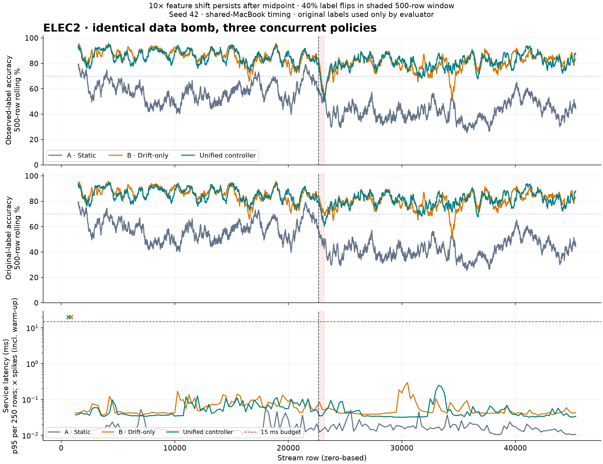
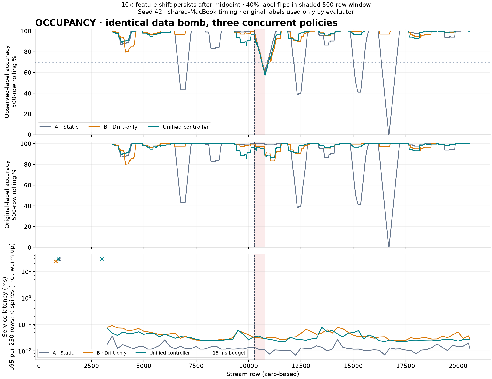

# Controller comparison

Three concurrent subprocesses per dataset; datasets run sequentially. Shared-machine latency; one seed, no confidence intervals. No claim of superiority.

| Dataset / policy | Before accuracy | Corrupted-window accuracy | After accuracy | Mean ms | p99 ms | Misses after warm-up / full run |
| --- | ---: | ---: | ---: | ---: | ---: | ---: |
| elec2/static | 58.08% | 49.80% | 42.07% | 0.01205 | 0.04337 | 0 / 1 |
| elec2/drift | 85.94% | 54.20% | 80.06% | 0.04334 | 0.20686 | 0 / 1 |
| elec2/unified | 85.69% | 51.00% | 81.23% | 0.03633 | 0.15970 | 0 / 1 |
| occupancy/static | 93.71% | 59.80% | 87.36% | 0.00986 | 0.02720 | 0 / 1 |
| occupancy/drift | 97.84% | 59.20% | 97.91% | 0.03068 | 0.12099 | 0 / 1 |
| occupancy/unified | 97.73% | 57.80% | 98.26% | 0.02505 | 0.07917 | 0 / 2 |

Mean/p99 latency metrics exclude warm-up. Spike markers and full-run miss counts include warm-up. Warm-up spikes triggered feature reductions in the unified runs, influencing their later trajectories; this comparison does not isolate post-drift resource effects. A prediction of the original label is wrong against a flipped label, so noise-window accuracy must be interpreted with original-label scores in the plots.

No artificial latency fault is enabled unless explicitly requested. Static freezes after warm-up. Drift-only keeps learning with ADWIN resets. Unified adds the shared latency/accuracy controller. All start with the same model, preprocessing, features and seed.

Fault setting: 0 ms. Raw evidence: /Users/utsavsingh/Documents/Adaptive_ML_Studio/results/controller-comparison/20261014T193730390999Z

Implemented paper subset: R1 drift response, R3 feature reduction, R4 accuracy refresh. Resource-gated R1/R4 and R2/R5 are not claimed.

