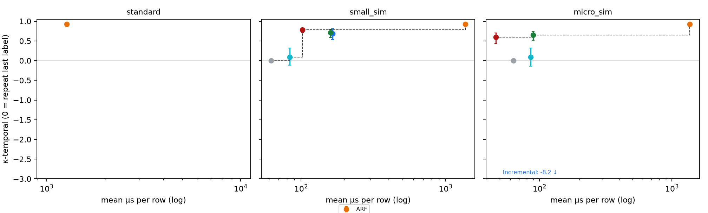
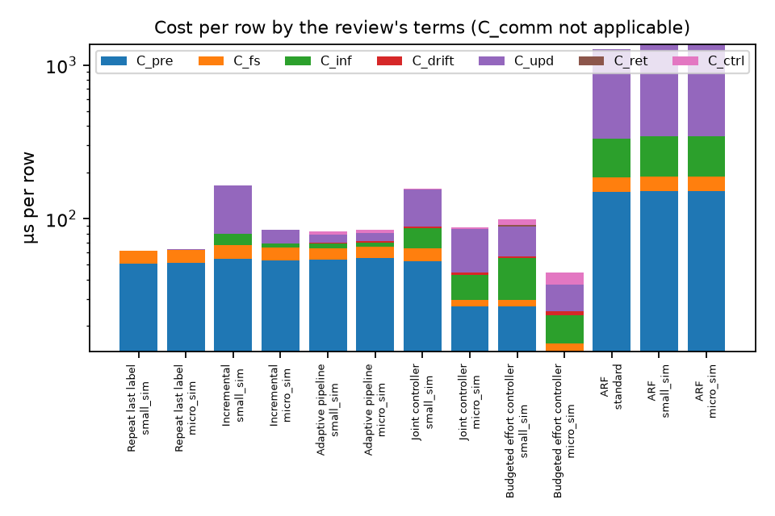
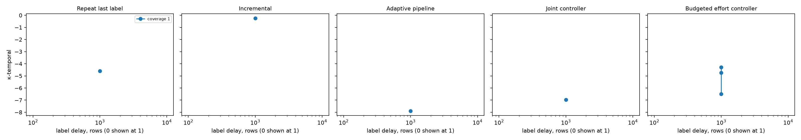

# Research testbed report — effort

31 trials from 16 experiment runs. Scores are after warm-up. κ-temporal is accuracy beyond repeating the previous row's label (0 = no better). Intervals are 95 % block-bootstrap intervals (10,000-row blocks, 1000 resamples, counts summed over seeds).

Device tiers other than `standard` are **simulated with placeholder budgets**. Energy is not measured.

**Trials ran 3 at a time on one machine; timings include contention.**

## Core methods

| Setting | Method | Tier | κ-temporal [95 % CI] | Macro-F1 | Attack recall % | False alarms % | Mean µs/row | p99 µs | Model changes |
|---|---|---|---|--:|--:|--:|--:|--:|--:|
| core | Repeat last label | small_sim | 0.000 [0.000, 0.000] | 0.973 | 97.8 | 3.2 | 62.2 | 75.7 | 0 |
| core | Repeat last label | micro_sim | 0.000 [0.000, 0.000] | 0.973 | 97.8 | 3.2 | 63.5 | 90.6 | 0 |
| core | Incremental | small_sim | 0.689 [0.534, 0.813] | 0.992 | 99.0 | 0.5 | 165.1 | 280.9 | 0 |
| core | Incremental | micro_sim | -8.204 [-15.104, -4.081] | 0.757 | 73.6 | 20.6 | 84.9 | 211.6 | 0 |
| core | Adaptive pipeline | small_sim | 0.092 [-0.118, 0.317] | 0.975 | 98.3 | 3.3 | 83.5 | 121.5 | 111 |
| core | Adaptive pipeline | micro_sim | 0.086 [-0.138, 0.318] | 0.975 | 98.2 | 3.3 | 85.5 | 154.9 | 110 |
| core | Joint controller | small_sim | 0.708 [0.590, 0.790] | 0.992 | 99.2 | 0.8 | 159.5 | 233.0 | 60 |
| core | Joint controller | micro_sim | 0.652 [0.516, 0.741] | 0.991 | 99.0 | 0.8 | 89.6 | 194.5 | 67 |
| core | Budgeted effort controller | small_sim | 0.782 [0.713, 0.827] | 0.994 | 99.4 | 0.5 | 102.2 | 274.7 | 39 |
| core | Budgeted effort controller | micro_sim | 0.595 [0.435, 0.706] | 0.989 | 99.0 | 1.1 | 46.7 | 137.7 | 69 |

## Literature ensembles

| Setting | Method | Tier | κ-temporal [95 % CI] | Macro-F1 | Attack recall % | False alarms % | Mean µs/row | p99 µs | Model changes |
|---|---|---|---|--:|--:|--:|--:|--:|--:|
| ensembles | ARF | standard | 0.922 [0.900, 0.940] | 0.998 | 99.8 | 0.2 | 1270.7 | 2946.8 | 0 |
| ensembles | ARF | small_sim | 0.922 [0.900, 0.940] | 0.998 | 99.8 | 0.2 | 1367.7 | 3293.9 | 0 |
| ensembles | ARF | micro_sim | 0.921 [0.897, 0.940] | 0.998 | 99.8 | 0.2 | 1365.4 | 3292.4 | 0 |

## Ablations of the budgeted effort controller

| Setting | Method | Tier | κ-temporal [95 % CI] | Macro-F1 | Attack recall % | False alarms % | Mean µs/row | p99 µs | Model changes |
|---|---|---|---|--:|--:|--:|--:|--:|--:|
| effort_ablations_measured_cost | Budgeted effort controller | small_sim | 0.756 [0.657, 0.821] | 0.993 | 99.2 | 0.5 | 77.7 | 212.8 | 42 |
| effort_ablations_without_activity_signal | Budgeted effort controller | small_sim | 0.636 [0.505, 0.718] | 0.990 | 99.0 | 0.9 | 100.6 | 329.2 | 65 |
| effort_ablations_without_damping | Budgeted effort controller | small_sim | 0.778 [0.704, 0.825] | 0.994 | 99.4 | 0.5 | 124.9 | 612.5 | 40 |
| effort_ablations_without_easy_skip | Budgeted effort controller | small_sim | 0.682 [0.550, 0.772] | 0.991 | 99.1 | 0.7 | 95.4 | 222.7 | 56 |
| effort_ablations_without_fast_switch | Budgeted effort controller | small_sim | 0.651 [0.499, 0.753] | 0.991 | 99.0 | 0.8 | 107.7 | 320.0 | 45 |
| effort_ablations_without_feature_gate | Budgeted effort controller | small_sim | 0.782 [0.713, 0.827] | 0.994 | 99.4 | 0.5 | 121.7 | 603.9 | 39 |
| effort_ablations_without_live_ranking | Budgeted effort controller | small_sim | 0.691 [0.582, 0.764] | 0.992 | 99.0 | 0.6 | 106.0 | 269.0 | 61 |
| effort_ablations_without_narrow_preprocessing | Budgeted effort controller | small_sim | 0.770 [0.697, 0.817] | 0.994 | 99.3 | 0.4 | 106.4 | 267.2 | 44 |
| effort_ablations_without_price | Budgeted effort controller | small_sim | 0.673 [0.534, 0.764] | 0.991 | 99.2 | 0.9 | 153.7 | 348.6 | 59 |
| effort_ablations_without_sampled_statistics | Budgeted effort controller | small_sim | 0.717 [0.609, 0.785] | 0.992 | 99.2 | 0.6 | 87.2 | 235.7 | 51 |

## Delayed and partial labels

κ-temporal here still uses the *immediately* previous label as its reference. With delayed labels a deployed system cannot see that label, so the reference is stricter than any method could reach: compare methods with each other, not with 0.

| Setting | Method | Tier | κ-temporal [95 % CI] | Macro-F1 | Attack recall % | False alarms % | Mean µs/row | p99 µs | Model changes |
|---|---|---|---|--:|--:|--:|--:|--:|--:|
| labels_delay1000 | Repeat last label | small_sim | -4.593 [-6.194, -3.491] | 0.849 | 87.7 | 17.9 | 71.1 | 94.4 | 0 |
| labels_delay1000 | Incremental | small_sim | -0.255 [-1.053, 0.299] | 0.966 | 95.5 | 1.5 | 182.5 | 293.4 | 0 |
| labels_delay1000 | Adaptive pipeline | small_sim | -7.896 [-11.161, -5.650] | 0.767 | 68.3 | 10.9 | 90.0 | 143.0 | 414 |
| labels_delay1000 | Joint controller | small_sim | -6.977 [-10.223, -4.652] | 0.791 | 71.1 | 9.1 | 177.2 | 261.3 | 208 |
| labels_delay1000 | Budgeted effort controller | small_sim | -6.492 [-9.737, -4.173] | 0.804 | 71.2 | 6.1 | 100.0 | 299.5 | 138 |
| labels_delay1000_effort_posthoc_race_only | Budgeted effort controller | small_sim | -4.735 [-7.579, -2.702] | 0.850 | 77.9 | 4.7 | 95.1 | 300.8 | 121 |
| labels_delay1000_effort_without_delay_awareness | Budgeted effort controller | small_sim | -4.280 [-6.821, -2.621] | 0.861 | 79.9 | 4.6 | 106.7 | 297.8 | 103 |

## Figures

## Methods compared over stream segments (Friedman, Nemenyi)

Not enough methods or segments in these runs.

## Errors, onsets and cost against the budget

| Setting | Method | Tier | Errors | κ-temporal [95 % CI] | Attack recall % | False alarms % | Σ flows before first flag (onsets) | Modelled µs/row | Measured µs/row | Budget µs/row | Rows over deadline % |
|---|---|---|--:|---|--:|--:|--:|--:|--:|--:|--:|
| core | Repeat last label | small_sim | 7,570 | 0.000 [0.000, 0.000] | 97.8 | 3.2 | 14 | — | 62.2 | — | 0.0 |
| core | Repeat last label | micro_sim | 7,570 | 0.000 [0.000, 0.000] | 97.8 | 3.2 | 14 | — | 63.5 | — | 0.1 |
| core | Incremental | small_sim | 2,472 | 0.689 [0.534, 0.813] | 99.0 | 0.5 | 692 | — | 165.1 | — | 0.6 |
| core | Incremental | micro_sim | 78,655 | -8.204 [-15.104, -4.081] | 73.6 | 20.6 | 44,402 | — | 84.9 | — | 1.5 |
| core | Adaptive pipeline | small_sim | 6,872 | 0.092 [-0.118, 0.317] | 98.3 | 3.3 | 79 | — | 83.5 | — | 0.0 |
| core | Adaptive pipeline | micro_sim | 6,920 | 0.086 [-0.138, 0.318] | 98.2 | 3.3 | 60 | — | 85.5 | — | 0.4 |
| core | Joint controller | small_sim | 2,275 | 0.708 [0.590, 0.790] | 99.2 | 0.8 | 66 | — | 159.5 | 100 | 0.6 |
| core | Joint controller | micro_sim | 2,638 | 0.652 [0.516, 0.741] | 99.0 | 0.8 | 82 | — | 89.6 | 50 | 0.8 |
| core | Budgeted effort controller | small_sim | 1,660 | 0.782 [0.713, 0.827] | 99.4 | 0.5 | 96 | 92.2 | 102.2 | 100 | 0.4 |
| core | Budgeted effort controller | micro_sim | 3,099 | 0.595 [0.435, 0.706] | 99.0 | 1.1 | 64 | 49.0 | 46.7 | 50 | 0.5 |
| effort_ablations_measured_cost | Budgeted effort controller | small_sim | 1,847 | 0.756 [0.657, 0.821] | 99.2 | 0.5 | 114 | 75.1 | 77.7 | 100 | 0.4 |
| effort_ablations_without_activity_signal | Budgeted effort controller | small_sim | 2,765 | 0.636 [0.505, 0.718] | 99.0 | 0.9 | 93 | 92.7 | 100.6 | 100 | 0.6 |
| effort_ablations_without_damping | Budgeted effort controller | small_sim | 1,683 | 0.778 [0.704, 0.825] | 99.4 | 0.5 | 96 | 92.1 | 124.9 | 100 | 1.3 |
| effort_ablations_without_easy_skip | Budgeted effort controller | small_sim | 2,426 | 0.682 [0.550, 0.772] | 99.1 | 0.7 | 72 | 92.1 | 95.4 | 100 | 0.5 |
| effort_ablations_without_fast_switch | Budgeted effort controller | small_sim | 2,645 | 0.651 [0.499, 0.753] | 99.0 | 0.8 | 127 | 91.8 | 107.7 | 100 | 0.6 |
| effort_ablations_without_feature_gate | Budgeted effort controller | small_sim | 1,660 | 0.782 [0.713, 0.827] | 99.4 | 0.5 | 96 | 92.2 | 121.7 | 100 | 1.3 |
| effort_ablations_without_live_ranking | Budgeted effort controller | small_sim | 2,342 | 0.691 [0.582, 0.764] | 99.0 | 0.6 | 59 | 93.6 | 106.0 | 100 | 0.4 |
| effort_ablations_without_narrow_preprocessing | Budgeted effort controller | small_sim | 1,741 | 0.770 [0.697, 0.817] | 99.3 | 0.4 | 98 | 95.6 | 106.4 | 100 | 0.4 |
| effort_ablations_without_price | Budgeted effort controller | small_sim | 2,472 | 0.673 [0.534, 0.764] | 99.2 | 0.9 | 105 | 142.2 | 153.7 | 100 | 0.7 |
| effort_ablations_without_sampled_statistics | Budgeted effort controller | small_sim | 2,144 | 0.717 [0.609, 0.785] | 99.2 | 0.6 | 98 | 82.6 | 87.2 | 100 | 0.4 |
| ensembles | ARF | standard | 589 | 0.922 [0.900, 0.940] | 99.8 | 0.2 | 67 | — | 1270.7 | — | — |
| ensembles | ARF | small_sim | 589 | 0.922 [0.900, 0.940] | 99.8 | 0.2 | 67 | — | 1367.7 | — | 100.0 |
| ensembles | ARF | micro_sim | 599 | 0.921 [0.897, 0.940] | 99.8 | 0.2 | 67 | — | 1365.4 | — | 100.0 |
| labels_delay1000 | Repeat last label | small_sim | 42,338 | -4.593 [-6.194, -3.491] | 87.7 | 17.9 | 1,817 | — | 71.1 | — | 0.0 |
| labels_delay1000 | Incremental | small_sim | 9,602 | -0.255 [-1.053, 0.299] | 95.5 | 1.5 | 1,813 | — | 182.5 | — | 0.6 |
| labels_delay1000 | Adaptive pipeline | small_sim | 67,347 | -7.896 [-11.161, -5.650] | 68.3 | 10.9 | 2,123 | — | 90.0 | — | 0.0 |
| labels_delay1000 | Joint controller | small_sim | 60,387 | -6.977 [-10.223, -4.652] | 71.1 | 9.1 | 2,071 | — | 177.2 | 100 | 0.6 |
| labels_delay1000 | Budgeted effort controller | small_sim | 56,712 | -6.492 [-9.737, -4.173] | 71.2 | 6.1 | 3,727 | 87.3 | 100.0 | 100 | 0.5 |
| labels_delay1000_effort_posthoc_race_only | Budgeted effort controller | small_sim | 43,792 | -4.735 [-7.579, -2.702] | 77.9 | 4.7 | 4,130 | 83.5 | 95.1 | 100 | 0.5 |
| labels_delay1000_effort_without_delay_awareness | Budgeted effort controller | small_sim | 39,973 | -4.280 [-6.821, -2.621] | 79.9 | 4.6 | 3,095 | 92.2 | 106.7 | 100 | 0.5 |
| repeat | Budgeted effort controller | small_sim | 1,660 | 0.782 [0.713, 0.827] | 99.4 | 0.5 | 96 | 92.2 | 98.8 | 100 | 0.4 |

## Budgeted effort controller

| Setting | Tier | Seed | Rows per level | Mean modelled / measured µs vs budget | Final · peak price | Updates skipped % | Statistics rows % | Ranking rows % | Final features | Fast switches · damped · muted · warm starts | Actions |
|---|---|--:|---|---|---|--:|--:|--:|--:|---|---|
| core | small_sim | 11 | cheap 148,101 · medium 63,278 · rich 87,621 | 92.2 / 102.2 vs 100 | 0.00 · 5.00 | 53.5 | 41.5 | 7.6 | 56 | 12 · 1 · 0 · 0 | PRICE_HALVE_FEATURES_56_TO_28 ×1, R1_DRIFT ×19, R2_DRIFT ×20, RELAX_FEATURES_28_TO_56 ×1 |
| core | micro_sim | 11 | cheap 122,643 · medium 10,025 · rich 166,332 | 49.0 / 46.7 vs 50 | 0.01 · 5.00 | 38.9 | 61.3 | 8.0 | 8 | 0 · 7 · 0 · 0 | PRICE_HALVE_FEATURES_14_TO_8 ×1, PRICE_HALVE_FEATURES_28_TO_14 ×1, PRICE_HALVE_FEATURES_56_TO_28 ×1, R1_DRIFT ×67, R2_DRIFT ×8 |
| effort_ablations_measured_cost | small_sim | 11 | cheap 138,272 · medium 17,835 · rich 142,893 | 75.1 / 77.7 vs 100 | 0.00 · 5.00 | 44.7 | 54.7 | 7.7 | 28 | 27 · 0 · 0 · 0 | PRICE_HALVE_FEATURES_56_TO_28 ×1, R1_DRIFT ×36, R2_DRIFT ×5 |
| effort_ablations_without_activity_signal | small_sim | 11 | cheap 12,207 · medium 38,361 · rich 248,432 | 92.7 / 100.6 vs 100 | 0.00 · 5.00 | 10.1 | 88.0 | 9.9 | 28 | 48 · 4 · 0 · 0 | PRICE_HALVE_FEATURES_56_TO_28 ×1, R1_DRIFT ×64, R2_DRIFT ×6 |
| effort_ablations_without_damping | small_sim | 11 | cheap 148,597 · medium 62,845 · rich 87,558 | 92.1 / 124.9 vs 100 | 0.00 · 5.00 | 53.6 | 41.5 | 7.6 | 56 | 12 · 0 · 0 · 0 | PRICE_HALVE_FEATURES_56_TO_28 ×1, R1_DRIFT ×19, R2_DRIFT ×20, RELAX_FEATURES_28_TO_56 ×1 |
| effort_ablations_without_easy_skip | small_sim | 11 | cheap 129,611 · medium 1,768 · rich 167,621 | 92.1 / 95.4 vs 100 | 0.00 · 5.00 | 0.0 | 61.0 | 7.9 | 28 | 46 · 3 · 0 · 0 | PRICE_HALVE_FEATURES_56_TO_28 ×1, R1_DRIFT ×57, R2_DRIFT ×2 |
| effort_ablations_without_fast_switch | small_sim | 11 | cheap 148,207 · medium 65,242 · rich 85,551 | 91.8 / 107.7 vs 100 | 0.00 · 5.00 | 53.8 | 41.1 | 7.6 | 56 | 0 · 2 · 0 · 0 | PRICE_HALVE_FEATURES_56_TO_28 ×1, R1_DRIFT ×27, R2_DRIFT ×20, RELAX_FEATURES_28_TO_56 ×1 |
| effort_ablations_without_feature_gate | small_sim | 11 | cheap 148,101 · medium 63,278 · rich 87,621 | 92.2 / 121.7 vs 100 | 0.00 · 5.00 | 53.5 | 41.5 | 7.6 | 56 | 12 · 1 · 0 · 0 | PRICE_HALVE_FEATURES_56_TO_28 ×1, R1_DRIFT ×19, R2_DRIFT ×20, RELAX_FEATURES_28_TO_56 ×1 |
| effort_ablations_without_live_ranking | small_sim | 11 | cheap 136,277 · medium 80,104 · rich 82,619 | 93.6 / 106.0 vs 100 | 0.00 · 5.00 | 53.0 | 37.2 | 0.0 | 56 | 21 · 0 · 0 · 0 | R1_DRIFT ×33, R2_DRIFT ×29 |
| effort_ablations_without_narrow_preprocessing | small_sim | 11 | cheap 151,669 · medium 111,225 · rich 36,106 | 95.6 / 106.4 vs 100 | 0.00 · 5.00 | 53.6 | 29.5 | 7.5 | 56 | 11 · 1 · 0 · 0 | PRICE_HALVE_FEATURES_56_TO_28 ×1, R1_DRIFT ×16, R2_DRIFT ×27, RELAX_FEATURES_28_TO_56 ×1 |
| effort_ablations_without_price | small_sim | 11 | cheap 0 · medium 0 · rich 299,000 | 142.2 / 153.7 vs 100 | 0.00 · 0.00 | 0.0 | 100.0 | 10.1 | 56 | 47 · 3 · 0 · 0 | R1_DRIFT ×63 |
| effort_ablations_without_sampled_statistics | small_sim | 11 | cheap 131,732 · medium 1,896 · rich 165,372 | 82.6 / 87.2 vs 100 | 0.00 · 5.00 | 42.3 | 100.0 | 7.9 | 28 | 34 · 1 · 0 · 0 | PRICE_HALVE_FEATURES_56_TO_28 ×1, R1_DRIFT ×48, R2_DRIFT ×4 |
| labels_delay1000 | small_sim | 11 | cheap 105,331 · medium 31,854 · rich 161,815 | 87.3 / 100.0 vs 100 | 0.00 · 5.00 | 35.3 | 61.3 | 8.3 | 56 | 111 · 37 · 20,480 · 137 | PRICE_HALVE_FEATURES_56_TO_28 ×3, R1_DRIFT ×169, RELAX_FEATURES_28_TO_56 ×3 |
| labels_delay1000_effort_posthoc_race_only | small_sim | 11 | cheap 114,154 · medium 18,107 · rich 166,739 | 83.5 / 95.1 vs 100 | 0.00 · 5.00 | 37.6 | 61.7 | 8.1 | 28 | 106 · 26 · 14,985 · 120 | PRICE_HALVE_FEATURES_56_TO_28 ×3, R1_DRIFT ×143, RELAX_FEATURES_28_TO_56 ×2 |
| labels_delay1000_effort_without_delay_awareness | small_sim | 11 | cheap 116,641 · medium 83,425 · rich 98,934 | 92.2 / 106.7 vs 100 | 0.00 · 5.00 | 42.8 | 46.1 | 8.1 | 56 | 35 · 61 · 0 · 0 | PRICE_HALVE_FEATURES_56_TO_28 ×3, R1_DRIFT ×64, R2_DRIFT ×105, RELAX_FEATURES_28_TO_56 ×3 |
| repeat | small_sim | 11 | cheap 148,101 · medium 63,278 · rich 87,621 | 92.2 / 98.8 vs 100 | 0.00 · 5.00 | 53.5 | 41.5 | 7.6 | 56 | 12 · 1 · 0 · 0 | PRICE_HALVE_FEATURES_56_TO_28 ×1, R1_DRIFT ×19, R2_DRIFT ×20, RELAX_FEATURES_28_TO_56 ×1 |

## Controller decisions

| Setting | Method | Tier | Seed | Rows in lightweight mode | Final features · stride · narrow | Peak model KB | Memory checks over budget | Actions |
|---|---|---|--:|--:|---|--:|--:|---|
| core | Joint controller | small_sim | 11 | 289,862 | 28 · 1 · yes | 990 | 0 of 299 | R1_DRIFT ×1, R2_DRIFT ×59, R3_HALVE_FEATURES_56_TO_28 ×1 |
| core | Joint controller | micro_sim | 11 | 298,999 | 28 · 1 · yes | 990 | 0 of 299 | R2_DRIFT ×67, R3_HALVE_FEATURES_56_TO_28 ×1 |
| core | Budgeted effort controller | small_sim | 11 | 144,943 | 56 · 1 · yes | 1549 | 0 of 299 | PRICE_HALVE_FEATURES_56_TO_28 ×1, R1_DRIFT ×19, R2_DRIFT ×20, RELAX_FEATURES_28_TO_56 ×1 |
| core | Budgeted effort controller | micro_sim | 11 | 63,939 | 8 · 1 · yes | 497 | 0 of 299 | PRICE_HALVE_FEATURES_14_TO_8 ×1, PRICE_HALVE_FEATURES_28_TO_14 ×1, PRICE_HALVE_FEATURES_56_TO_28 ×1, R1_DRIFT ×67, R2_DRIFT ×8 |
| effort_ablations_measured_cost | Budgeted effort controller | small_sim | 11 | 21,253 | 28 · 1 · yes | 1033 | 0 of 299 | PRICE_HALVE_FEATURES_56_TO_28 ×1, R1_DRIFT ×36, R2_DRIFT ×5 |
| effort_ablations_without_activity_signal | Budgeted effort controller | small_sim | 11 | 17,894 | 28 · 1 · yes | 885 | 0 of 299 | PRICE_HALVE_FEATURES_56_TO_28 ×1, R1_DRIFT ×64, R2_DRIFT ×6 |
| effort_ablations_without_damping | Budgeted effort controller | small_sim | 11 | 144,437 | 56 · 1 · yes | 1549 | 0 of 299 | PRICE_HALVE_FEATURES_56_TO_28 ×1, R1_DRIFT ×19, R2_DRIFT ×20, RELAX_FEATURES_28_TO_56 ×1 |
| effort_ablations_without_easy_skip | Budgeted effort controller | small_sim | 11 | 47,705 | 28 · 1 · yes | 886 | 0 of 299 | PRICE_HALVE_FEATURES_56_TO_28 ×1, R1_DRIFT ×57, R2_DRIFT ×2 |
| effort_ablations_without_fast_switch | Budgeted effort controller | small_sim | 11 | 116,548 | 56 · 1 · yes | 1978 | 0 of 299 | PRICE_HALVE_FEATURES_56_TO_28 ×1, R1_DRIFT ×27, R2_DRIFT ×20, RELAX_FEATURES_28_TO_56 ×1 |
| effort_ablations_without_feature_gate | Budgeted effort controller | small_sim | 11 | 144,943 | 56 · 1 · yes | 1549 | 0 of 299 | PRICE_HALVE_FEATURES_56_TO_28 ×1, R1_DRIFT ×19, R2_DRIFT ×20, RELAX_FEATURES_28_TO_56 ×1 |
| effort_ablations_without_live_ranking | Budgeted effort controller | small_sim | 11 | 114,806 | 56 · 1 · yes | 1163 | 0 of 299 | R1_DRIFT ×33, R2_DRIFT ×29 |
| effort_ablations_without_narrow_preprocessing | Budgeted effort controller | small_sim | 11 | 151,620 | 56 · 1 · no | 1978 | 0 of 299 | PRICE_HALVE_FEATURES_56_TO_28 ×1, R1_DRIFT ×16, R2_DRIFT ×27, RELAX_FEATURES_28_TO_56 ×1 |
| effort_ablations_without_price | Budgeted effort controller | small_sim | 11 | 0 | 56 · 1 · yes | 991 | 0 of 299 | R1_DRIFT ×63 |
| effort_ablations_without_sampled_statistics | Budgeted effort controller | small_sim | 11 | 17,423 | 28 · 1 · yes | 775 | 0 of 299 | PRICE_HALVE_FEATURES_56_TO_28 ×1, R1_DRIFT ×48, R2_DRIFT ×4 |
| labels_delay1000 | Joint controller | small_sim | 11 | 297,921 | 56 · 1 · no | 431 | 0 of 299 | R2_DRIFT ×231, R4_DEFERRED_RESOURCES_TIGHT ×122 |
| labels_delay1000 | Budgeted effort controller | small_sim | 11 | 0 | 56 · 1 · yes | 1377 | 0 of 299 | PRICE_HALVE_FEATURES_56_TO_28 ×3, R1_DRIFT ×169, RELAX_FEATURES_28_TO_56 ×3 |
| labels_delay1000_effort_posthoc_race_only | Budgeted effort controller | small_sim | 11 | 0 | 28 · 1 · yes | 1206 | 0 of 299 | PRICE_HALVE_FEATURES_56_TO_28 ×3, R1_DRIFT ×143, RELAX_FEATURES_28_TO_56 ×2 |
| labels_delay1000_effort_without_delay_awareness | Budgeted effort controller | small_sim | 11 | 157,214 | 56 · 1 · yes | 986 | 0 of 299 | PRICE_HALVE_FEATURES_56_TO_28 ×3, R1_DRIFT ×64, R2_DRIFT ×105, RELAX_FEATURES_28_TO_56 ×3 |
| repeat | Budgeted effort controller | small_sim | 11 | 144,943 | 56 · 1 · yes | 1549 | 0 of 299 | PRICE_HALVE_FEATURES_56_TO_28 ×1, R1_DRIFT ×19, R2_DRIFT ×20, RELAX_FEATURES_28_TO_56 ×1 |

## Reproducibility

No configuration was run more than once in these runs. Re-run one with `adaptiveml.experiments.rerun` (or run the protocol twice) to check reproducibility.

## Runs

- `core`: `20261111-235411-732352-experiment-effort-core-comparison-small-sim-and-mic`
- `ensembles`: `20261111-175111-293327-experiment-protocol-v1-quick-ensembles`
- `labels_delay1000`: `20261112-000025-518699-experiment-effort-label-delay-1000-small-sim`
- `labels_delay1000_effort_without_delay_awareness`: `20261112-000419-652774-experiment-effort-ablation-delay-1000-without-delay`
- `labels_delay1000_effort_posthoc_race_only`: `20261112-001226-375009-experiment-effort-post-hoc-variant-delay-1000-repla`
- `effort_ablations_without_narrow_preprocessing`: `20261112-000502-612439-experiment-effort-ablation-without-narrow-preproces`
- `effort_ablations_without_sampled_statistics`: `20261112-000545-245390-experiment-effort-ablation-without-sampled-statisti`
- `effort_ablations_without_live_ranking`: `20261112-000621-775642-experiment-effort-ablation-without-live-ranking-sma`
- `effort_ablations_without_easy_skip`: `20261112-000704-780931-experiment-effort-ablation-without-easy-skip-small-`
- `effort_ablations_without_feature_gate`: `20261112-000743-906493-experiment-effort-ablation-without-feature-gate-sma`
- `effort_ablations_without_price`: `20261112-000833-000288-experiment-effort-ablation-without-price-small-sim`
- `effort_ablations_without_activity_signal`: `20261112-000930-037397-experiment-effort-ablation-without-activity-signal-`
- `effort_ablations_without_fast_switch`: `20261112-001010-799231-experiment-effort-ablation-without-fast-switch-smal`
- `effort_ablations_without_damping`: `20261112-001053-767635-experiment-effort-ablation-without-damping-small-si`
- `effort_ablations_measured_cost`: `20261112-001143-656967-experiment-effort-ablation-measured-cost-small-sim`
- `repeat`: `20261112-001306-019166-experiment-effort-repeat-on-small-sim-determinism-c`
