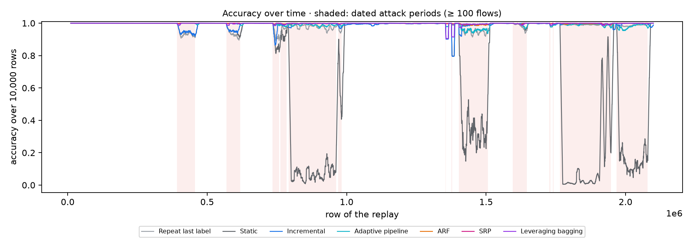
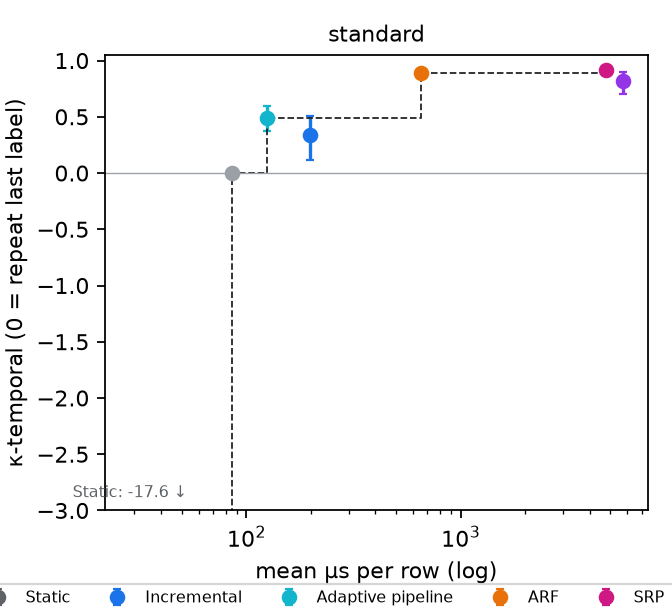
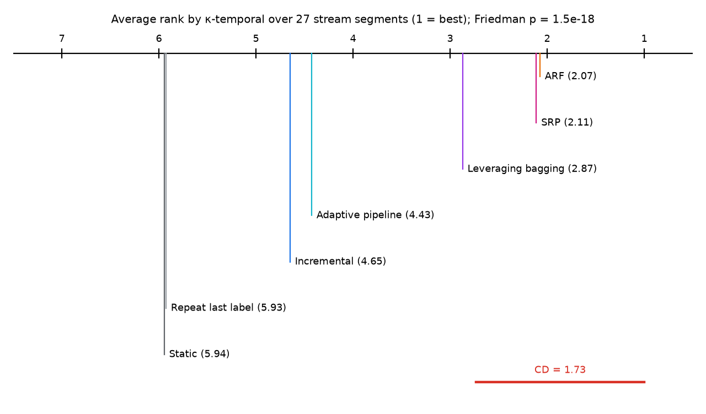

# Research testbed report — phase2

7 trials from 3 experiment runs. Scores are after warm-up. κ-temporal is accuracy beyond repeating the previous row's label (0 = no better). Intervals are 95 % block-bootstrap intervals (10,000-row blocks, 1000 resamples, counts summed over seeds).

Device tiers other than `standard` are **simulated with placeholder budgets**. Energy is not measured.

## Core methods

| Setting | Method | Tier | κ-temporal [95 % CI] | Macro-F1 | Attack recall % | False alarms % | Mean µs/row | p99 µs | Model changes |
|---|---|---|---|--:|--:|--:|--:|--:|--:|
| core | Repeat last label | standard | 0.000 [0.000, 0.000] | 0.982 | 97.3 | 0.9 | 85.8 | 194.3 | 0 |
| core | Static | standard | -17.575 [-23.213, -13.480] | 0.431 | 0.0 | 0.0 | 28.5 | 32.8 | 0 |
| core | Incremental | standard | 0.337 [0.115, 0.509] | 0.988 | 97.3 | 0.3 | 197.1 | 332.6 | 0 |
| core | Adaptive pipeline | standard | 0.491 [0.372, 0.598] | 0.991 | 98.7 | 0.5 | 125.0 | 170.7 | 256 |
| core | ARF | standard | 0.892 [0.864, 0.916] | 0.998 | 99.7 | 0.1 | 656.6 | 1842.5 | 0 |
| core | SRP | standard | 0.919 [0.896, 0.938] | 0.999 | 99.7 | 0.0 | 4790.0 | 16156.4 | 0 |
| core | Leveraging bagging | standard | 0.818 [0.702, 0.896] | 0.997 | 99.2 | 0.0 | 5751.1 | 16437.0 | 0 |

## Figures

## Methods compared over stream segments (Friedman, Nemenyi)

27 segments of 50,000 rows (per tier and seed), metric κ-temporal. Friedman χ² = 96.3, p = 1.5e-18; Iman–Davenport F = 38.1, p = 3e-28. Average ranks (1 = best): Repeat last label 5.93, Static 5.94, Incremental 4.65, Adaptive pipeline 4.43, ARF 2.07, SRP 2.11, Leveraging bagging 2.87. Nemenyi critical difference at α = 0.05: 1.73.

Segments of one stream are not independent datasets, so treat the test as descriptive.

## Reproducibility

No configuration was run more than once in these runs. Re-run one with `adaptiveml.experiments.rerun` (or run the protocol twice) to check reproducibility.

## Runs

- `core`: `20261111-145934-568975-experiment-phase-2-core-methods-on-cic-ids2017`
- `core`: `20261111-145938-211780-experiment-phase-2-srp-methods-on-cic-ids2017`
- `core`: `20261111-145941-337166-experiment-phase-2-levbag-methods-on-cic-ids2017`
