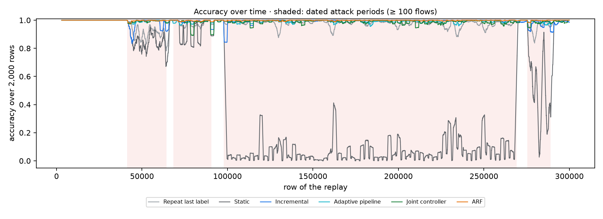
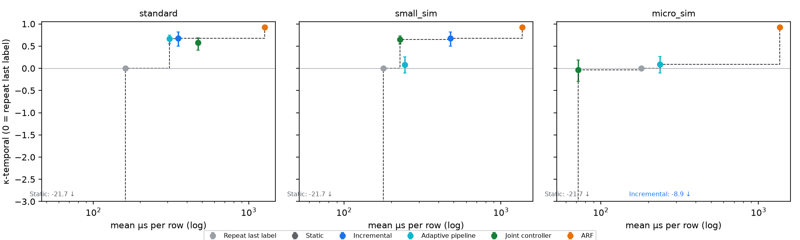
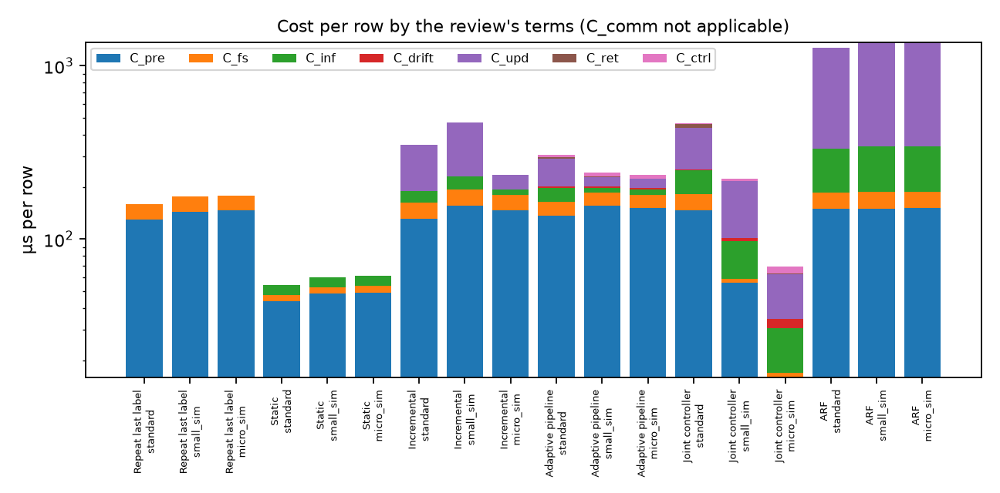
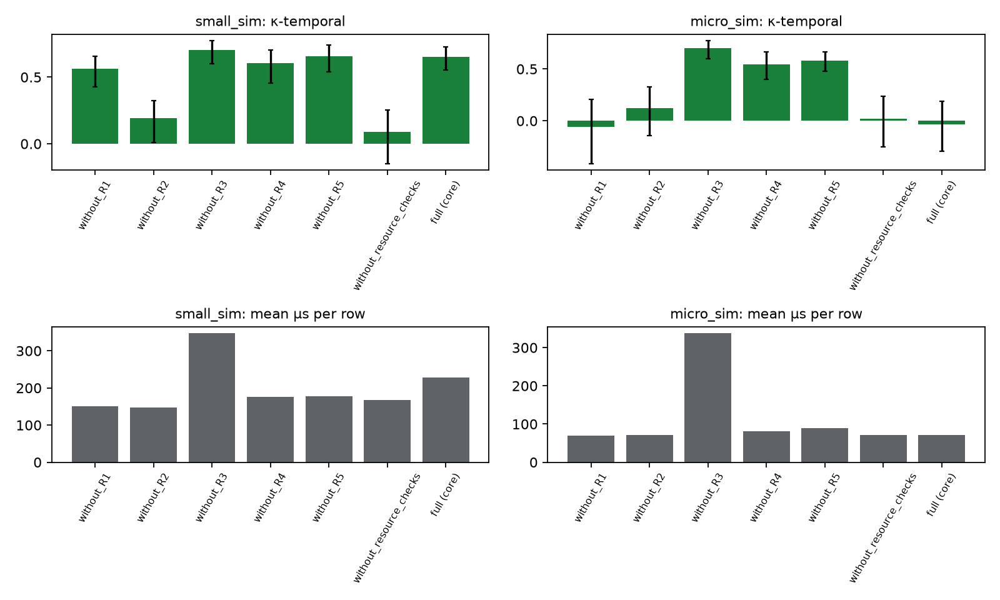
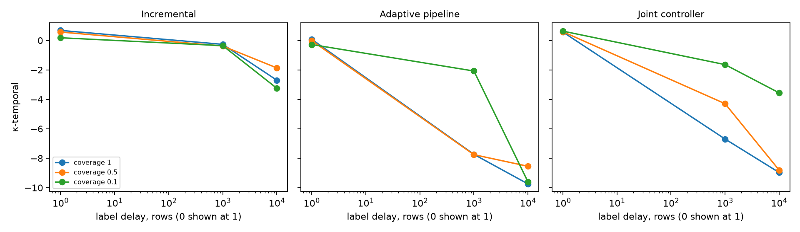
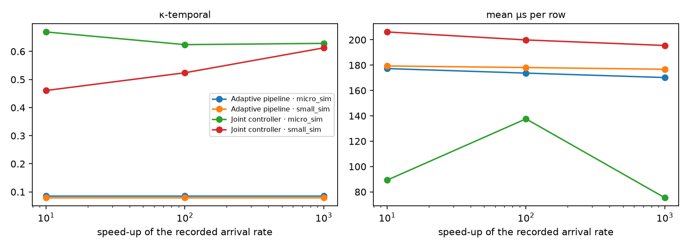
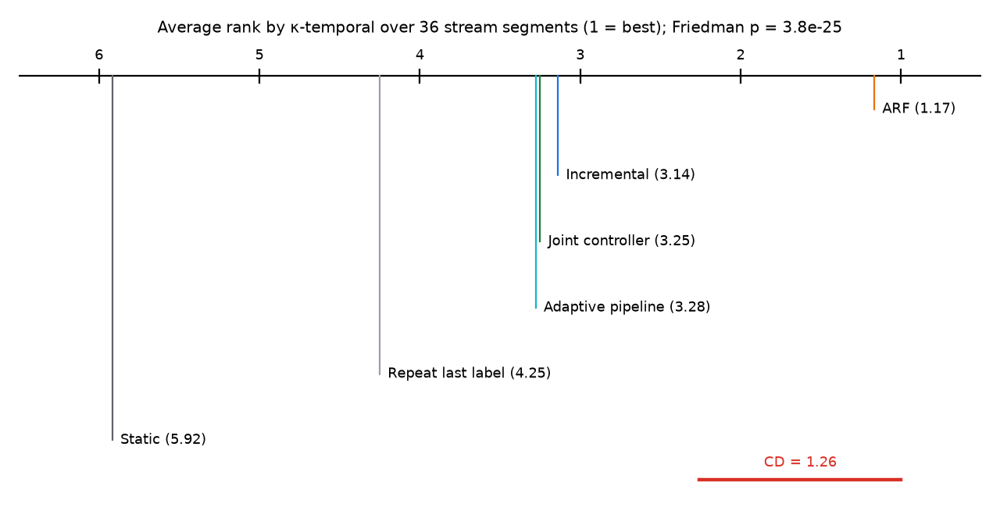

# Research testbed report — protocol-quick

69 trials from 20 experiment runs. Scores are after warm-up. κ-temporal is accuracy beyond repeating the previous row's label (0 = no better). Intervals are 95 % block-bootstrap intervals (5,000-row blocks, 1000 resamples, counts summed over seeds).

Device tiers other than `standard` are **simulated with placeholder budgets**. Energy is not measured.

**Trials ran 3 at a time on one machine; timings include contention.**

## Core methods

| Setting | Method | Tier | κ-temporal [95 % CI] | Macro-F1 | Attack recall % | False alarms % | Mean µs/row | p99 µs | Model changes |
|---|---|---|---|--:|--:|--:|--:|--:|--:|
| core | Repeat last label | standard | 0.000 [0.000, 0.000] | 0.974 | 97.8 | 3.1 | 161.0 | 264.3 | 0 |
| core | Repeat last label | small_sim | 0.000 [0.000, 0.000] | 0.974 | 97.8 | 3.1 | 178.3 | 294.0 | 0 |
| core | Repeat last label | micro_sim | 0.000 [0.000, 0.000] | 0.974 | 97.8 | 3.1 | 180.7 | 278.3 | 0 |
| core | Static | standard | -21.673 [-30.846, -15.662] | 0.295 | 0.0 | 0.0 | 54.5 | 111.2 | 0 |
| core | Static | small_sim | -21.673 [-30.846, -15.662] | 0.295 | 0.0 | 0.0 | 60.6 | 111.6 | 0 |
| core | Static | micro_sim | -21.673 [-30.846, -15.662] | 0.295 | 0.0 | 0.0 | 61.4 | 110.7 | 0 |
| core | Incremental | standard | 0.679 [0.498, 0.817] | 0.992 | 99.0 | 0.6 | 351.9 | 630.7 | 0 |
| core | Incremental | small_sim | 0.679 [0.498, 0.817] | 0.992 | 99.0 | 0.6 | 475.6 | 839.9 | 0 |
| core | Incremental | micro_sim | -8.862 [-14.579, -5.158] | 0.744 | 73.6 | 23.8 | 237.4 | 622.7 | 0 |
| core | Adaptive pipeline | standard | 0.668 [0.549, 0.748] | 0.991 | 99.1 | 0.8 | 308.6 | 562.6 | 66 |
| core | Adaptive pipeline | small_sim | 0.079 [-0.108, 0.263] | 0.976 | 98.2 | 3.2 | 244.1 | 393.5 | 108 |
| core | Adaptive pipeline | micro_sim | 0.086 [-0.108, 0.271] | 0.976 | 98.2 | 3.2 | 237.1 | 421.8 | 110 |
| core | Joint controller | standard | 0.577 [0.409, 0.689] | 0.989 | 98.9 | 1.1 | 472.2 | 990.4 | 58 |
| core | Joint controller | small_sim | 0.653 [0.555, 0.727] | 0.991 | 99.1 | 0.9 | 227.3 | 465.2 | 68 |
| core | Joint controller | micro_sim | -0.032 [-0.296, 0.187] | 0.973 | 98.3 | 3.9 | 72.0 | 184.0 | 104 |

## Literature ensembles

| Setting | Method | Tier | κ-temporal [95 % CI] | Macro-F1 | Attack recall % | False alarms % | Mean µs/row | p99 µs | Model changes |
|---|---|---|---|--:|--:|--:|--:|--:|--:|
| ensembles | ARF | standard | 0.922 [0.895, 0.942] | 0.998 | 99.8 | 0.2 | 1270.7 | 2946.8 | 0 |
| ensembles | ARF | small_sim | 0.922 [0.895, 0.942] | 0.998 | 99.8 | 0.2 | 1367.7 | 3293.9 | 0 |
| ensembles | ARF | micro_sim | 0.921 [0.894, 0.940] | 0.998 | 99.8 | 0.2 | 1365.4 | 3292.4 | 0 |

## Ablations of the joint controller

| Setting | Method | Tier | κ-temporal [95 % CI] | Macro-F1 | Attack recall % | False alarms % | Mean µs/row | p99 µs | Model changes |
|---|---|---|---|--:|--:|--:|--:|--:|--:|
| ablations_without_R1 | Joint controller | small_sim | 0.564 [0.426, 0.655] | 0.989 | 99.1 | 1.4 | 150.6 | 402.9 | 71 |
| ablations_without_R1 | Joint controller | micro_sim | -0.056 [-0.413, 0.208] | 0.972 | 98.6 | 4.5 | 68.9 | 186.5 | 96 |
| ablations_without_R2 | Joint controller | small_sim | 0.193 [0.008, 0.324] | 0.979 | 98.0 | 2.2 | 147.9 | 385.6 | 99 |
| ablations_without_R2 | Joint controller | micro_sim | 0.122 [-0.141, 0.326] | 0.977 | 98.8 | 3.8 | 71.5 | 158.0 | 98 |
| ablations_without_R3 | Joint controller | small_sim | 0.704 [0.599, 0.775] | 0.992 | 99.2 | 0.8 | 347.2 | 529.5 | 61 |
| ablations_without_R3 | Joint controller | micro_sim | 0.704 [0.599, 0.775] | 0.992 | 99.2 | 0.8 | 337.5 | 517.7 | 61 |
| ablations_without_R4 | Joint controller | small_sim | 0.603 [0.454, 0.702] | 0.990 | 99.0 | 1.0 | 176.0 | 452.2 | 77 |
| ablations_without_R4 | Joint controller | micro_sim | 0.545 [0.401, 0.663] | 0.988 | 99.3 | 1.9 | 81.3 | 138.8 | 66 |
| ablations_without_R5 | Joint controller | small_sim | 0.656 [0.539, 0.743] | 0.991 | 99.2 | 0.9 | 178.0 | 411.0 | 62 |
| ablations_without_R5 | Joint controller | micro_sim | 0.582 [0.478, 0.665] | 0.989 | 99.2 | 1.5 | 89.5 | 131.7 | 64 |
| ablations_without_resource_checks | Joint controller | small_sim | 0.090 [-0.149, 0.256] | 0.976 | 98.2 | 3.1 | 168.2 | 391.1 | 97 |
| ablations_without_resource_checks | Joint controller | micro_sim | 0.018 [-0.250, 0.238] | 0.974 | 98.7 | 4.2 | 72.1 | 166.3 | 115 |

## Delayed and partial labels

κ-temporal here still uses the *immediately* previous label as its reference. With delayed labels a deployed system cannot see that label, so the reference is stricter than any method could reach: compare methods with each other, not with 0.

| Setting | Method | Tier | κ-temporal [95 % CI] | Macro-F1 | Attack recall % | False alarms % | Mean µs/row | p99 µs | Model changes |
|---|---|---|---|--:|--:|--:|--:|--:|--:|
| labels_delay0_cov0.1 | Incremental | small_sim | 0.180 [-0.493, 0.608] | 0.978 | 97.3 | 1.3 | 108.6 | 461.8 | 0 |
| labels_delay0_cov0.1 | Adaptive pipeline | small_sim | -0.279 [-0.632, 0.119] | 0.966 | 97.0 | 3.6 | 90.7 | 267.4 | 10 |
| labels_delay0_cov0.1 | Joint controller | small_sim | 0.631 [0.423, 0.776] | 0.990 | 98.8 | 0.6 | 138.6 | 478.0 | 6 |
| labels_delay0_cov0.5 | Incremental | small_sim | 0.570 [0.355, 0.736] | 0.989 | 98.9 | 1.0 | 196.4 | 592.8 | 0 |
| labels_delay0_cov0.5 | Adaptive pipeline | small_sim | -0.012 [-0.221, 0.198] | 0.973 | 98.0 | 3.4 | 131.8 | 298.4 | 66 |
| labels_delay0_cov0.5 | Joint controller | small_sim | 0.590 [0.487, 0.672] | 0.989 | 99.2 | 1.3 | 133.6 | 427.1 | 36 |
| labels_delay0_cov1 | Incremental | small_sim | 0.679 [0.498, 0.817] | 0.992 | 99.0 | 0.6 | 299.1 | 659.9 | 0 |
| labels_delay0_cov1 | Adaptive pipeline | small_sim | 0.079 [-0.108, 0.263] | 0.976 | 98.2 | 3.2 | 174.2 | 315.9 | 108 |
| labels_delay0_cov1 | Joint controller | small_sim | 0.571 [0.419, 0.672] | 0.989 | 98.9 | 1.0 | 179.1 | 434.3 | 69 |
| labels_delay10000_cov0.1 | Incremental | small_sim | -3.248 [-6.187, -1.326] | 0.891 | 82.3 | 1.4 | 105.6 | 461.6 | 0 |
| labels_delay10000_cov0.1 | Adaptive pipeline | small_sim | -9.603 [-14.169, -6.789] | 0.727 | 67.2 | 19.4 | 87.0 | 271.3 | 238 |
| labels_delay10000_cov0.1 | Joint controller | small_sim | -3.561 [-6.683, -1.695] | 0.882 | 82.5 | 3.6 | 137.7 | 486.7 | 20 |
| labels_delay10000_cov0.5 | Incremental | small_sim | -1.866 [-4.237, -0.411] | 0.926 | 88.2 | 1.2 | 193.4 | 607.6 | 0 |
| labels_delay10000_cov0.5 | Adaptive pipeline | small_sim | -8.546 [-12.639, -5.976] | 0.754 | 69.4 | 16.1 | 130.3 | 311.0 | 307 |
| labels_delay10000_cov0.5 | Joint controller | small_sim | -8.807 [-13.204, -6.139] | 0.748 | 68.6 | 16.5 | 142.0 | 437.2 | 157 |
| labels_delay10000_cov1 | Incremental | small_sim | -2.699 [-5.291, -1.043] | 0.905 | 84.1 | 0.6 | 312.5 | 668.9 | 0 |
| labels_delay10000_cov1 | Adaptive pipeline | small_sim | -9.744 [-13.740, -7.238] | 0.724 | 62.1 | 13.2 | 178.0 | 343.0 | 299 |
| labels_delay10000_cov1 | Joint controller | small_sim | -8.970 [-13.060, -6.367] | 0.744 | 63.9 | 11.0 | 199.4 | 472.8 | 182 |
| labels_delay1000_cov0.1 | Incremental | small_sim | -0.356 [-1.388, 0.336] | 0.965 | 95.0 | 1.4 | 109.4 | 478.5 | 0 |
| labels_delay1000_cov0.1 | Adaptive pipeline | small_sim | -2.077 [-3.459, -0.960] | 0.919 | 93.0 | 9.1 | 90.5 | 275.8 | 60 |
| labels_delay1000_cov0.1 | Joint controller | small_sim | -1.642 [-3.070, -0.695] | 0.931 | 92.1 | 5.2 | 97.1 | 426.9 | 26 |
| labels_delay1000_cov0.5 | Incremental | small_sim | -0.382 [-1.069, 0.219] | 0.964 | 95.0 | 1.6 | 204.4 | 612.1 | 0 |
| labels_delay1000_cov0.5 | Adaptive pipeline | small_sim | -7.758 [-10.522, -5.834] | 0.775 | 69.3 | 11.1 | 137.5 | 331.7 | 353 |
| labels_delay1000_cov0.5 | Joint controller | small_sim | -4.296 [-6.247, -2.862] | 0.863 | 81.9 | 7.3 | 129.8 | 445.4 | 140 |
| labels_delay1000_cov1 | Incremental | small_sim | -0.266 [-1.031, 0.282] | 0.967 | 95.5 | 1.5 | 339.2 | 706.2 | 0 |
| labels_delay1000_cov1 | Adaptive pipeline | small_sim | -7.737 [-10.558, -5.975] | 0.776 | 68.3 | 9.4 | 193.6 | 362.0 | 301 |
| labels_delay1000_cov1 | Joint controller | small_sim | -6.695 [-9.031, -5.040] | 0.802 | 73.2 | 9.9 | 182.7 | 442.5 | 222 |

## Recorded arrival rate

| Setting | Method | Tier | κ-temporal [95 % CI] | Macro-F1 | Attack recall % | False alarms % | Mean µs/row | p99 µs | Model changes |
|---|---|---|---|--:|--:|--:|--:|--:|--:|
| rates_recordedx10 | Adaptive pipeline | small_sim | 0.079 [-0.108, 0.263] | 0.976 | 98.2 | 3.2 | 179.4 | 335.2 | 108 |
| rates_recordedx10 | Adaptive pipeline | micro_sim | 0.086 [-0.108, 0.271] | 0.976 | 98.2 | 3.2 | 177.3 | 334.8 | 110 |
| rates_recordedx10 | Joint controller | small_sim | 0.461 [0.286, 0.602] | 0.986 | 98.4 | 1.1 | 206.2 | 497.9 | 73 |
| rates_recordedx10 | Joint controller | micro_sim | 0.669 [0.565, 0.746] | 0.991 | 99.2 | 1.0 | 89.3 | 181.5 | 62 |
| rates_recordedx100 | Adaptive pipeline | small_sim | 0.079 [-0.108, 0.263] | 0.976 | 98.2 | 3.2 | 178.1 | 341.9 | 108 |
| rates_recordedx100 | Adaptive pipeline | micro_sim | 0.086 [-0.108, 0.271] | 0.976 | 98.2 | 3.2 | 173.7 | 311.2 | 110 |
| rates_recordedx100 | Joint controller | small_sim | 0.524 [0.360, 0.643] | 0.987 | 98.6 | 0.9 | 199.9 | 456.6 | 70 |
| rates_recordedx100 | Joint controller | micro_sim | 0.624 [0.503, 0.700] | 0.990 | 98.9 | 0.8 | 137.6 | 190.3 | 72 |
| rates_recordedx1000 | Adaptive pipeline | small_sim | 0.079 [-0.108, 0.263] | 0.976 | 98.2 | 3.2 | 176.8 | 339.0 | 108 |
| rates_recordedx1000 | Adaptive pipeline | micro_sim | 0.086 [-0.108, 0.271] | 0.976 | 98.2 | 3.2 | 170.2 | 305.7 | 110 |
| rates_recordedx1000 | Joint controller | small_sim | 0.613 [0.465, 0.706] | 0.990 | 99.0 | 1.0 | 195.5 | 452.2 | 67 |
| rates_recordedx1000 | Joint controller | micro_sim | 0.629 [0.471, 0.747] | 0.990 | 99.5 | 1.5 | 75.4 | 184.1 | 55 |

## Figures

## Methods compared over stream segments (Friedman, Nemenyi)

36 segments of 20,000 rows (per tier and seed), metric κ-temporal. Friedman χ² = 124.3, p = 3.8e-25; Iman–Davenport F = 78.2, p = 9e-43. Average ranks (1 = best): Repeat last label 4.25, Static 5.92, Incremental 3.14, Adaptive pipeline 3.28, ARF 1.17, Joint controller 3.25. Nemenyi critical difference at α = 0.05: 1.26.

Segments of one stream are not independent datasets, so treat the test as descriptive.

## Joint controller decisions

| Setting | Tier | Seed | Rows in lightweight mode | Final features · stride · narrow | Actions |
|---|---|--:|--:|---|---|
| ablations_without_R1 | small_sim | 11 | 269,976 | 14 · 1 · yes | R1_OFF_DRIFT_IGNORED ×7, R2_DRIFT ×69, R3_HALVE_FEATURES_28_TO_14 ×1, R3_HALVE_FEATURES_56_TO_28 ×1 |
| ablations_without_R1 | micro_sim | 11 | 282,172 | 2 · 2 · yes | R1_OFF_DRIFT_IGNORED ×19, R2_DRIFT ×92, R3_HALVE_FEATURES_14_TO_7 ×1, R3_HALVE_FEATURES_28_TO_14 ×1, R3_HALVE_FEATURES_3_TO_2 ×1, R3_HALVE_FEATURES_56_TO_28 ×1, R3_HALVE_FEATURES_7_TO_3 ×1, R3_UPDATE_EVERY_2 ×1, R4_DEFERRED_RESOURCES_TIGHT ×6, R4_RETRAIN ×2 |
| ablations_without_R2 | small_sim | 11 | 0 | 28 · 1 · yes | R1_DRIFT ×106, R3_HALVE_FEATURES_28_TO_14 ×1, R3_HALVE_FEATURES_56_TO_28 ×1, R3_RELAX_FEATURES_14_TO_28 ×1 |
| ablations_without_R2 | micro_sim | 11 | 0 | 3 · 1 · yes | R1_DRIFT ×105, R3_HALVE_FEATURES_14_TO_7 ×1, R3_HALVE_FEATURES_28_TO_14 ×1, R3_HALVE_FEATURES_56_TO_28 ×1, R3_HALVE_FEATURES_7_TO_3 ×1, R4_DEFERRED_RESOURCES_TIGHT ×2 |
| ablations_without_R3 | small_sim | 11 | 298,999 | 56 · 1 · no | R2_DRIFT ×61 |
| ablations_without_R3 | micro_sim | 11 | 298,999 | 56 · 1 · no | R2_DRIFT ×61 |
| ablations_without_R4 | small_sim | 11 | 298,999 | 28 · 1 · yes | R2_DRIFT ×79, R3_HALVE_FEATURES_56_TO_28 ×1 |
| ablations_without_R4 | micro_sim | 11 | 298,999 | 7 · 1 · yes | R2_DRIFT ×67, R3_HALVE_FEATURES_14_TO_7 ×1, R3_HALVE_FEATURES_28_TO_14 ×1, R3_HALVE_FEATURES_56_TO_28 ×1 |
| ablations_without_R5 | small_sim | 11 | 298,999 | 28 · 1 · yes | R2_DRIFT ×62, R3_HALVE_FEATURES_56_TO_28 ×1 |
| ablations_without_R5 | micro_sim | 11 | 298,999 | 14 · 1 · yes | R2_DRIFT ×63, R3_HALVE_FEATURES_28_TO_14 ×1, R3_HALVE_FEATURES_56_TO_28 ×1 |
| ablations_without_resource_checks | small_sim | 11 | 0 | 14 · 1 · yes | R1_DRIFT ×106, R3_HALVE_FEATURES_14_TO_7 ×1, R3_HALVE_FEATURES_28_TO_14 ×1, R3_HALVE_FEATURES_56_TO_28 ×1, R3_RELAX_FEATURES_7_TO_14 ×1 |
| ablations_without_resource_checks | micro_sim | 11 | 0 | 3 · 1 · yes | R1_DRIFT ×119, R3_HALVE_FEATURES_14_TO_7 ×1, R3_HALVE_FEATURES_28_TO_14 ×1, R3_HALVE_FEATURES_56_TO_28 ×1, R3_HALVE_FEATURES_7_TO_3 ×1, R4_RETRAIN ×3 |
| core | standard | 11 | 0 | 56 · 1 · no | R1_DRIFT ×59 |
| core | small_sim | 11 | 298,999 | 14 · 1 · yes | R2_DRIFT ×67, R3_HALVE_FEATURES_28_TO_14 ×1, R3_HALVE_FEATURES_56_TO_28 ×1 |
| core | micro_sim | 11 | 180,334 | 2 · 4 · yes | R1_DRIFT ×70, R2_DRIFT ×41, R3_HALVE_FEATURES_14_TO_7 ×1, R3_HALVE_FEATURES_28_TO_14 ×1, R3_HALVE_FEATURES_3_TO_2 ×1, R3_HALVE_FEATURES_56_TO_28 ×1, R3_HALVE_FEATURES_7_TO_3 ×1, R3_UPDATE_EVERY_2 ×1, R3_UPDATE_EVERY_4 ×1, R4_DEFERRED_RESOURCES_TIGHT ×1, R4_RETRAIN ×1 |
| labels_delay0_cov0.1 | small_sim | 11 | 284,433 | 56 · 1 · no | R2_DRIFT ×6 |
| labels_delay0_cov0.5 | small_sim | 11 | 297,169 | 28 · 1 · yes | R2_DRIFT ×35, R3_HALVE_FEATURES_56_TO_28 ×1 |
| labels_delay0_cov1 | small_sim | 11 | 298,999 | 28 · 1 · yes | R2_DRIFT ×68, R3_HALVE_FEATURES_56_TO_28 ×1, R4_DEFERRED_RESOURCES_TIGHT ×1 |
| labels_delay10000_cov0.1 | small_sim | 11 | 255,988 | 56 · 1 · no | R1_DRIFT ×1, R2_DRIFT ×18, R4_DEFERRED_RESOURCES_TIGHT ×56, R4_RETRAIN ×1 |
| labels_delay10000_cov0.5 | small_sim | 11 | 291,942 | 28 · 1 · yes | R1_DRIFT ×1, R2_DRIFT ×153, R3_HALVE_FEATURES_56_TO_28 ×1, R4_DEFERRED_RESOURCES_TIGHT ×153, R4_RETRAIN ×10 |
| labels_delay10000_cov1 | small_sim | 11 | 293,343 | 28 · 1 · yes | R2_DRIFT ×212, R3_HALVE_FEATURES_56_TO_28 ×1, R4_DEFERRED_RESOURCES_TIGHT ×145 |
| labels_delay1000_cov0.1 | small_sim | 11 | 165,624 | 28 · 1 · yes | R1_DRIFT ×4, R2_DRIFT ×19, R3_HALVE_FEATURES_56_TO_28 ×1, R4_DEFERRED_RESOURCES_TIGHT ×7, R4_RETRAIN ×2 |
| labels_delay1000_cov0.5 | small_sim | 11 | 287,453 | 28 · 1 · yes | R1_DRIFT ×1, R2_DRIFT ×136, R3_HALVE_FEATURES_56_TO_28 ×1, R4_DEFERRED_RESOURCES_TIGHT ×86, R4_RETRAIN ×3 |
| labels_delay1000_cov1 | small_sim | 11 | 298,621 | 28 · 1 · yes | R2_DRIFT ×253, R3_HALVE_FEATURES_56_TO_28 ×1, R4_DEFERRED_RESOURCES_TIGHT ×108 |
| rates_recordedx10 | small_sim | 11 | 103,985 | 28 · 1 · yes | R1_DRIFT ×50, R2_DRIFT ×25, R3_HALVE_FEATURES_56_TO_28 ×1 |
| rates_recordedx10 | micro_sim | 11 | 102,445 | 14 · 1 · yes | R1_DRIFT ×51, R2_DRIFT ×10, R3_HALVE_FEATURES_28_TO_14 ×1, R3_HALVE_FEATURES_56_TO_28 ×1 |
| rates_recordedx100 | small_sim | 11 | 216,178 | 28 · 1 · yes | R1_DRIFT ×14, R2_DRIFT ×56, R3_HALVE_FEATURES_56_TO_28 ×1 |
| rates_recordedx100 | micro_sim | 11 | 235,453 | 28 · 1 · yes | R1_DRIFT ×5, R2_DRIFT ×67, R3_HALVE_FEATURES_56_TO_28 ×1 |
| rates_recordedx1000 | small_sim | 11 | 298,999 | 28 · 1 · yes | R2_DRIFT ×68, R3_HALVE_FEATURES_56_TO_28 ×1 |
| rates_recordedx1000 | micro_sim | 11 | 297,617 | 7 · 1 · yes | R2_DRIFT ×55, R3_HALVE_FEATURES_14_TO_7 ×1, R3_HALVE_FEATURES_28_TO_14 ×1, R3_HALVE_FEATURES_56_TO_28 ×1 |

## Reproducibility

3 configurations were run more than once; 2 produced identical predictions in every repeat.
1 groups differ between repeats: joint. The joint and adaptive controllers react to measured time, so repeats under different load can differ.

## Runs

- `core`: `20261111-174330-804788-experiment-protocol-v1-quick-core`
- `ensembles`: `20261111-175111-293327-experiment-protocol-v1-quick-ensembles`
- `ablations_without_resource_checks`: `20261111-175826-464150-experiment-protocol-v1-quick-ablations-without-reso`
- `ablations_without_R1`: `20261111-175936-486916-experiment-protocol-v1-quick-ablations-without-r1`
- `ablations_without_R2`: `20261111-180043-127883-experiment-protocol-v1-quick-ablations-without-r2`
- `ablations_without_R3`: `20261111-180145-207996-experiment-protocol-v1-quick-ablations-without-r3`
- `ablations_without_R4`: `20261111-180346-254533-experiment-protocol-v1-quick-ablations-without-r4`
- `ablations_without_R5`: `20261111-180454-216144-experiment-protocol-v1-quick-ablations-without-r5`
- `labels_delay0_cov1`: `20261111-180602-391133-experiment-protocol-v1-quick-labels-delay0-cov1`
- `labels_delay0_cov0.5`: `20261111-180748-327971-experiment-protocol-v1-quick-labels-delay0-cov0-5`
- `labels_delay0_cov0.1`: `20261111-180903-893584-experiment-protocol-v1-quick-labels-delay0-cov0-1`
- `labels_delay1000_cov1`: `20261111-181002-469215-experiment-protocol-v1-quick-labels-delay1000-cov1`
- `labels_delay1000_cov0.5`: `20261111-181201-566376-experiment-protocol-v1-quick-labels-delay1000-cov0-`
- `labels_delay1000_cov0.1`: `20261111-181320-180151-experiment-protocol-v1-quick-labels-delay1000-cov0-`
- `labels_delay10000_cov1`: `20261111-181410-199251-experiment-protocol-v1-quick-labels-delay10000-cov1`
- `labels_delay10000_cov0.5`: `20261111-181600-904346-experiment-protocol-v1-quick-labels-delay10000-cov0`
- `labels_delay10000_cov0.1`: `20261111-181715-830367-experiment-protocol-v1-quick-labels-delay10000-cov0`
- `rates_recordedx10`: `20261111-181813-820738-experiment-protocol-v1-quick-rates-recordedx10`
- `rates_recordedx100`: `20261111-182007-671153-experiment-protocol-v1-quick-rates-recordedx100`
- `rates_recordedx1000`: `20261111-182214-571007-experiment-protocol-v1-quick-rates-recordedx1000`
